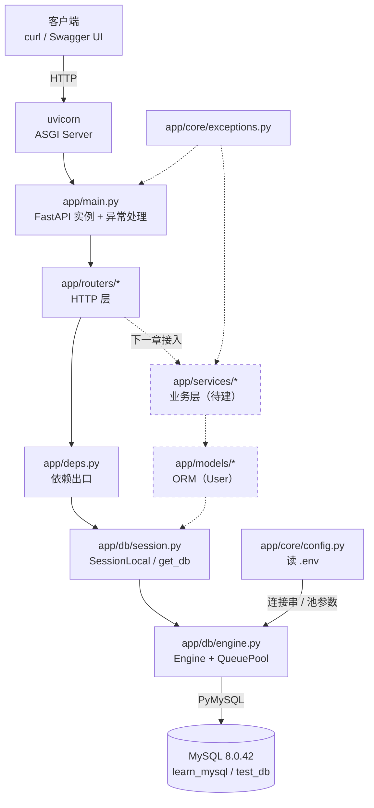
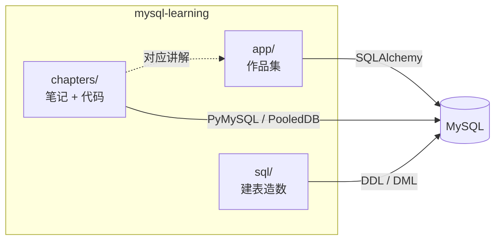

# 项目架构

> 更新时间：2026-11-04 · 章节结构改为 `chapters/chNN/{notes,code}`
> 说明：`app/` 是作品集（第 4 章起长业务代码），`chapters/` 是学习轨迹，两者互不 import。

## 1. 全貌

```plain
┌──────────────────────────── mysql-learning（学习仓库）────────────────────────────┐
│                                                                                  │
│   ┌────────────────────────┐              ┌────────────────────────┐             │
│   │  app/  作品集           │              │  chapters/  学习区      │             │
│   │  FastAPI 分层应用       │              │  每章一个目录            │             │
│   │  （第 4 章起长肉）      │              │  chNN/notes + chNN/code │             │
│   └───────────┬────────────┘              └───────────┬────────────┘             │
│               │                                       │                          │
│        SQLAlchemy 2.x                          PyMySQL / DBUtils                  │
│        Engine + Session                        PooledDB                          │
│               │                                       │                          │
│               └──────────────┬────────────────────────┘                          │
│                              ▼                                                   │
│                    ┌───────────────────┐                                         │
│                    │   MySQL 8.0.42    │                                         │
│                    │ learn_mysql       │                                         │
│                    │ test_db           │                                         │
│                    └───────────────────┘                                         │
│                                                                                  │
│   支撑材料：sql/（建表造数）  docs/（架构·规划·文档规范）  migrations/（迁移）      │
└──────────────────────────────────────────────────────────────────────────────────┘
```

## 2. 应用分层（app/）

调用方向**单向向下**，反向依赖视为设计错误。

```plain
                        客户端（curl / Swagger UI / 前端）
                                    │ HTTP
                                    ▼
                    ┌───────────────────────────────┐
                    │  uvicorn  (ASGI Server)       │
                    └───────────────┬───────────────┘
                                    ▼
        ┌───────────────────────────────────────────────────────┐
        │  app/main.py            ✅ 已实现                      │
        │    · FastAPI 实例                                     │
        │    · lifespan：启动预热 / 关闭时 engine.dispose()      │
        │    · exception_handler：AppError → {"detail": ...}     │
        │    · include_router()                                 │
        └───────────────────────────┬───────────────────────────┘
                                    ▼
        ┌───────────────────────────────────────────────────────┐
        │  app/routers/*          ⚠️ 仅有 health.py              │
        │    入参校验 · 状态码 · Depends(get_db)                 │
        │    禁止：写 SQL、写业务规则                             │
        └───────────────────────────┬───────────────────────────┘
                                    ▼
        ┌───────────────────────────────────────────────────────┐
        │  app/services/*         ❌ 空，待第四章填充            │
        │    业务规则 · 事务边界 · 抛 AppError                   │
        └───────────────────────────┬───────────────────────────┘
                                    ▼
        ┌───────────────────────────────────────────────────────┐
        │  app/models/*           ✅ User 模型（第三章）          │
        │    SQLAlchemy 实体映射                                 │
        └───────────────────────────┬───────────────────────────┘
                                    ▼
        ┌───────────────────────────────────────────────────────┐
        │  app/db/session.py      ✅ SessionLocal + get_db       │
        │  app/db/engine.py       ✅ Engine + QueuePool          │
        │  app/db/base.py         ✅ DeclarativeBase             │
        └───────────────────────────┬───────────────────────────┘
                                    ▼
                              MySQL 8.0.42
```

**旁路依赖**（不是调用链，是横切关注点）：

| 模块 | 谁在用 | 作用 |
| --- | --- | --- |
| `app/core/config.py` | `db/engine.py` | 读 `.env`，输出连接串与池参数 |
| `app/core/exceptions.py` | `services/`（未来）、`main.py` | 业务异常定义 → 统一 HTTP 映射 |
| `app/deps.py` | `routers/` | 依赖出口，隔离 router 与 db |

## 3. 一次 `/health/db` 请求的完整链路

```plain
① 客户端 GET /health/db
        │
②      ▼  uvicorn 收到请求，交给 FastAPI
        │
③      ▼  app/main.py 路由匹配 → health 路由
        │
④      ▼  app/routers/health.py::health_db(db: Session = Depends(get_db))
        │     FastAPI 解析 Depends，调用 get_db()
        │
⑤      ▼  app/deps.py → app/db/session.py::get_db()
        │     SessionLocal() 从连接池取一条连接
        │
⑥      ▼  app/db/engine.py::engine（QueuePool，pool_pre_ping=True）
        │
⑦      ▼  SQLAlchemy → PyMySQL → TCP 3306
        │
⑧      ▼  MySQL 执行 SELECT VERSION()
        │
⑨      ▼  结果逐层返回，finally 中 db.close() 把连接还给池
        │
⑩      ▼  JSONResponse {"status": "ok", "mysql_version": "8.0.42"}
```

## 4. 两条数据访问路径

仓库里同时存在两套访问方式，这是刻意的：`chapters/*/code/` 用裸驱动理解原理，`app/` 用 ORM 做工程。

| 维度 | practice 路径 | app 路径 |
| --- | --- | --- |
| 驱动 | PyMySQL 直连 / DBUtils.PooledDB | SQLAlchemy + PyMySQL |
| 连接池 | 手写 `PooledDB(...)` | `create_engine` 自带 `QueuePool` |
| 池参数 | `mincached` / `maxcached` / `maxconnections` / `blocking` / `ping` | `pool_size` / `max_overflow` / `pool_recycle` / `pool_pre_ping` |
| 事务 | `conn.commit()` / `rollback()` | `Session.commit()` / `rollback()` |
| 代表文件 | `chapters/ch02/code/pool.py` | `app/db/engine.py` |

第二章的结论在这里直接复用：**`close()` 在池化语境下是归还，不是断开**。SQLAlchemy 的 `Session.close()` 同理，归还连接但不销毁池。

## 5. 数据库现状

### learn_mysql（第一 ~ 二章练习）

| 表 | 行数 | 用途 |
| --- | --- | --- |
| `students` | 4 | 单表 CRUD |
| `users` / `orders` / `order_items` / `products` | 3 / 3 / 4 / 3 | 多表关联与事务 |
| `books` / `authors` / `readers` / `borrows` | 0 | JOIN 练习（图书借阅模型） |
| `tags` | 0 | 多对多 |
| `big_users` | 99,822 | 索引与 EXPLAIN 压测 |

### test_db（第二章改造对象）

| 表 | 行数 | 用途 |
| --- | --- | --- |
| `user` / `role` / `user_role` | 3 / 3 / 4 | 用户-角色 RBAC |
| `articles` / `categories` / `comments` / `tags` / `article_tags` | 0 | 博客建模练习 |
| `blog_users` | 0 | 博客用户 |
| `orders` | 3 | 订单 |
| `big_users` | 100,239 | 索引压测 |

## 6. 完成度

| 层 | 文件 | 状态 | 对应章节 |
| --- | --- | --- | --- |
| 配置 | `core/config.py` | ✅ | 第三章 |
| 异常 | `core/exceptions.py` | ✅ | 第六章 |
| 连接 | `db/engine.py`、`db/session.py`、`db/base.py` | ✅ | 第三章 |
| 路由 | `routers/health.py` | ✅ 探针 | 第六章 |
| 路由 | `routers/users.py` 等 | ❌ | 第六、七章 |
| 模型 | `models/user.py` | ✅ | 第三章 |
| 校验 | `schemas/*` | ❌ 空 | 第六章 |
| 业务 | `services/*` | ❌ 空 | 第四、五章 |
| 迁移 | `migrations/`（Alembic） | ✅ 基线 `0001_initial` | 第三章 |
| 测试 | `tests/` | 未建 | 第七章 |

## 7. Mermaid 版本（GitHub 直接渲染）





## 8. 演进路线

```plain
第一、二章 ✅ ──► 第三章 ✅：models/user.py + Alembic 基线 0001_initial
                     ──► 第四章：services + routers，用户 CRUD
                     ──► 第五章：relationship + RBAC（roles / permissions / user_roles）
                     ──► 第六章：RESTful API + Pydantic 校验 + 分页
                     ──► 第七章：认证、测试、完整项目收口
```

`app/` 当前是**可运行的骨架 + 一个 User 模型**：服务能起、库能连、ORM 能查出真实数据、迁移版本可控。但 `services/` 和 `schemas/` 还空着，所以还没有业务接口——那是第四章的事。
